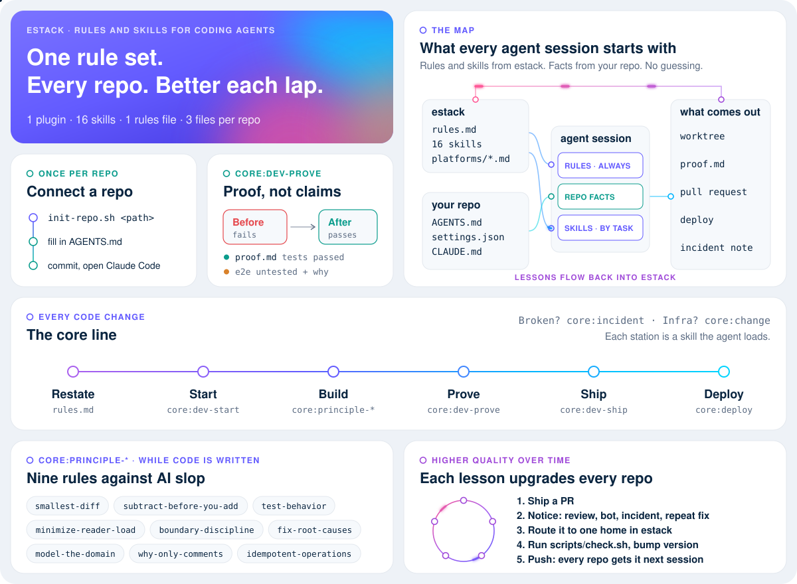

# estack

My agent stack for Claude Code: one set of rules and skills, reused by
every work repo.



## How it helps coding agents

- **Same start every session.** A hook loads `plugins/core/rules.md`, so
  the agent knows when to ask, what is unsafe, and how to report.
- **Facts, not guesses.** Each repo's `AGENTS.md` names its deploy
  targets and checks. If a fact is missing, the agent asks.
- **One route for every change.** `core:dev-start`, `core:dev-prove`,
  `core:dev-ship`. Each PR carries proof from before and after the change.
- **Less slop.** The `principle-*` skills shape code while it is written.
- **Better every lap.** A lesson goes into one home in estack. Every repo
  gets it in its next session.

## How it fits together

```
estack (this repo)
└── core       rules + skills every repo uses

each repo
├── .claude/settings.json   turns on core
└── AGENTS.md               facts only: deploy targets, checks, process
```

Rules are written once, in `plugins/core/rules.md`. A hook loads them at
the start of every session. Repos hold only their own facts.

## Skills

| Plugin | Skills |
|---|---|
| core | `dev-start`, `dev-prove`, `dev-ship`, `deploy`, `change`, `incident`, `write-plain` |
| core principles | `principle-smallest-diff`, `principle-subtract-before-you-add`, `principle-model-the-domain`, `principle-minimize-reader-load`, `principle-boundary-discipline`, `principle-why-only-comments`, `principle-test-behavior`, `principle-fix-root-causes` |

Call a skill as `plugin:skill`, for example `core:deploy`. The agent also
picks skills on its own from their descriptions.

The principle skills are code rules that cut AI slop while code is
written. To steer the agent, name one: "apply subtract before you add".
They are adapted from [pstack](https://github.com/backnotprop/pstack).
See `NOTICE.md`.

`core:deploy` is one procedure for every platform. Platform commands live
in `plugins/core/skills/deploy/platforms/`: `compose-ssh` (home lab),
`railway`, `vercel`. Add more with `_template.md`.

## Connect a repo

From a clone of estack:

```bash
scripts/init-repo.sh ~/code/some-repo
```

Then fill in the `<...>` fields in that repo's `AGENTS.md` and commit.
Claude Code offers to install the plugin the next time it opens the repo.

## Use in Codex

Codex reads this marketplace as it is. Skills keep the same names, such
as `core:deploy`. Codex does not load the rules through the hook without
extra approval, so a script copies them into Codex's global `AGENTS.md`:

```bash
scripts/codex-setup.sh
```

Rerun it after estack changes. Your own text in `~/.codex/AGENTS.md` stays.

If Codex asks you to trust estack's hook, answer no. The rules already
load from `AGENTS.md`, and a yes loads them twice.

Each repo's own `AGENTS.md` works in Codex with no setup.

## Install by hand

Inside Claude Code:

```
/plugin marketplace add agustinkiko/estack
/plugin install core@estack
```

## Change estack

Read `AGENTS.md` first. Run `scripts/check.sh` before you push.
